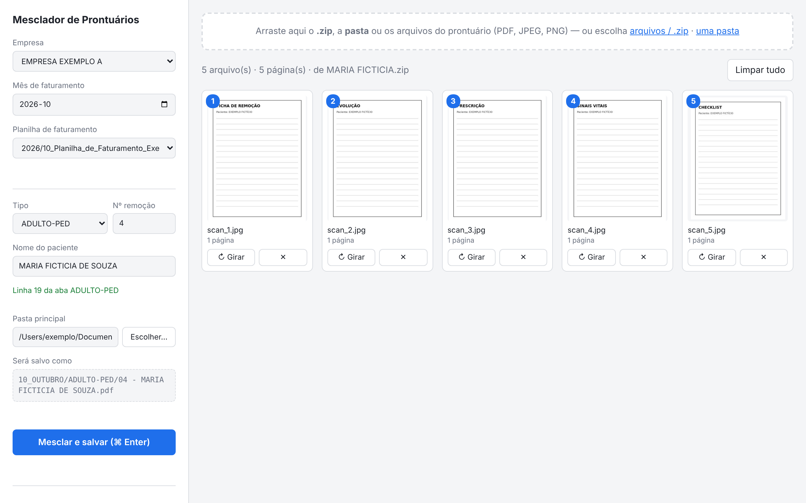
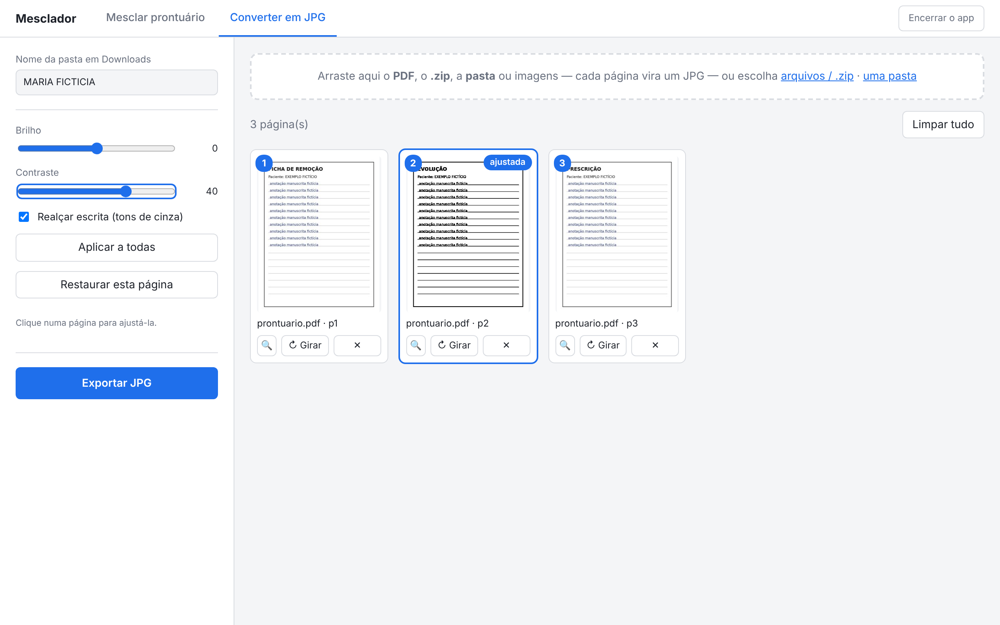

# Mesclador de Prontuários

Ferramenta local para montar, um a um, os prontuários que acompanham o faturamento de remoções em UTI móvel: junta as folhas escaneadas (PDF/JPEG/PNG) na ordem certa, busca o nome do paciente na planilha de faturamento pelo Nº da remoção e salva o PDF com o nome e na pasta corretos. O app tem duas telas, acessadas pela barra superior: **Mesclar prontuário** e **Converter em JPG**.


_Dados fictícios._

## O problema

Na auditoria de faturamento, cada remoção precisa de um prontuário em PDF nomeado como `04 - NOME DO PACIENTE.pdf` e arquivado na pasta do mês, separado por tipo de remoção (adulto/pediátrico ou neonatal). As folhas chegam escaneadas separadamente, em formatos misturados, com nomes de arquivo sem padrão.

O fluxo manual era: baixar as folhas em `.zip`, extrair, enviar para um site de mesclagem online, baixar o resultado, renomear consultando a planilha e mover para a pasta certa. Além de lento, isso enviava **dados de saúde de pacientes para um serviço de terceiros**.

## O que a ferramenta faz

- Arrastar o **.zip baixado**, a **pasta** extraída ou os arquivos soltos; as folhas entram em ordem natural (`pag2` antes de `pag10`) e o lixo do macOS (`__MACOSX`, `.DS_Store`) é ignorado
- Reconhecer Formulário, BDV e FDR pelo nome do arquivo e sugerir a ordem da SESAB; a ordem final é sempre do usuário
- Reordenar arrastando os cartões, girar folhas escaneadas de lado, remover folhas; PDFs com várias páginas são separados em um cartão por página
- Na ampliação das duas telas, navegar entre as folhas pelas setas do teclado ou da tela, com posição e nome do arquivo
- Ajustar brilho, contraste e realce por folha na própria tela de mesclar; só as folhas ajustadas viram imagem no PDF final, as demais entram sem alteração
- Escolher o tipo configurado e digitar o Nº da remoção → o nome vem da aba certa da planilha `.xlsx` (a numeração recomeça em cada aba)
- Os tipos ADULTO-PED COVID e NEONATAL COVID aparecem quando configurados em `config.toml` (veja `config.example.toml`).
- Quando o .zip ou a pasta tem o nome do paciente, sugerir tipo, Nº e nome a partir da planilha; se houver mais de uma remoção com esse nome, você escolhe a correta
- Se o zip ou a pasta não identifica o paciente, usar nomes concordantes dos arquivos para sugerir a remoção quando ela existir na planilha
- Pré-seleciona a planilha do mês escolhido (pelo mês/ano no caminho do arquivo) e ignora versões antigas/backups
- Você escolhe a pasta principal no seletor nativo do macOS; o app usa a subpasta do tipo (`ADULTO…` / `NEO…`) e a cria se não existir
- Nº com 2 dígitos (`04`, `05`, `10`) para a ordenação ficar certa
- Mostra o caminho final antes de salvar e não sobrescreve sem confirmação
- Confere o nome: quando o zip ou a pasta vem com o nome do paciente, o app compara com o nome da planilha; se não bater, mostra um aviso e pede confirmação ao salvar (zips genéricos `drive-download-…` não são conferidos)
- Roda **só no computador** (`127.0.0.1`): nenhum arquivo sai da máquina, sem dependência de internet

## Converter em JPG


_Dados fictícios._

Quando a folha escaneada está escura ou difícil de ler, a tela **Converter em JPG** transforma as páginas em imagens ajustáveis. O uso típico: converter, ajustar a legibilidade e voltar pela tela de mesclar para montar o PDF.

- Aceita **PDF**, **.zip**, **pasta** ou imagens; cada página vira um cartão
- Ajustes **por página** (brilho, contraste e realçar escrita), com prévia no cartão; **Aplicar a todas** copia os ajustes da página selecionada para as demais e **Restaurar esta página** desfaz os ajustes dela
- Ampliar a página com 🔍, girar e remover
- Exporta para `Downloads/<nome>/<nome> - 01.jpg…` em 200 DPI, sem sobrescrever (se a pasta já existir, cria `<nome> (2)`), com o botão **Mostrar no Finder**

## Decisões de projeto

| Decisão                                           | Motivo                                                                                                                    |
| ------------------------------------------------- | ------------------------------------------------------------------------------------------------------------------------- |
| Um prontuário por vez, não em lote                | A ordem das folhas e a escolha do que entra dependem da auditoria humana; automatizar isso esconderia erros               |
| App web local (Flask) em vez de interface desktop | Arrastar e soltar e miniaturas saem prontos no navegador; nenhuma biblioteca externa de front-end, então funciona offline |
| `.gitignore` bloqueia PDF, imagens e planilhas    | Evita que um prontuário real seja versionado por engano                                                                   |
| Não sobrescreve e mostra a prévia do caminho      | Um arquivo com nome errado vira glosa                                                                                     |
| Ajustes só na página inteira                      | Melhora a legibilidade sem alterar o conteúdo registrado no prontuário; não há ferramenta para apagar ou editar trechos   |
| Conferência de nome avisa, não bloqueia           | O nome da pasta no Drive pode estar abreviado ou escrito diferente; a decisão final é de quem audita                      |
| Ordem SESAB sugerida por lote                      | Os nomes ajudam a organizar as fichas-base, mas o usuário pode ajustar a ordem antes de salvar                             |

## Instalação

Requer Python 3.9+.

```bash
git clone https://github.com/Piaulucas/mesclador-prontuarios.git
cd mesclador-prontuarios
python3 -m venv .venv && source .venv/bin/activate
pip install -r requirements.txt
cp config.example.toml config.toml   # edite caminhos, empresas e colunas da planilha
```

## Uso

```bash
python3 -m mesclador
```

O navegador abre em `http://127.0.0.1:5050`. Para encerrar, use o botão **Encerrar o app** na barra superior (`Ctrl+C` continua valendo quando aberto pelo terminal).
Se o app já estiver aberto e o código da pasta tiver mudado (ex.: depois de atualizar o projeto), abrir de novo pelo ícone ou pelo comando encerra o app antigo e abre o novo; se o código for o mesmo, só mostra a janela que já existe.

1. Escolha empresa e mês (a planilha do mês é selecionada sozinha)
2. Escolha a pasta principal do mês (fica lembrada por empresa e mês)
3. Arraste o .zip do Drive (ou a pasta, ou os arquivos) e confira a ordem
4. Confira o tipo, Nº e nome sugeridos; se o Nº não vier sugerido, escolha o tipo, digite o Nº e pressione Enter
5. `⌘ Enter` (ou o botão) para mesclar e salvar

### Abrir com um ícone (macOS)

Para não precisar do Terminal no dia a dia, crie o ícone uma vez:

```bash
bash macos/criar_app.sh
```

Isso gera `~/Applications/Mesclador.app`; arraste-o para o Dock. O ícone abre o app em segundo plano e, se ele já estiver aberto, só mostra a janela de novo. Para fechar, use o botão **Encerrar o app** na tela. O registro de execução fica em `~/Library/Logs/mesclador.log`. Se a pasta do projeto mudar de lugar, rode o script de novo.

## Configuração

Tudo fica em `config.toml` (veja os comentários em [`config.example.toml`](config.example.toml)):

- `pasta_inicial`: onde o seletor de pasta abre na primeira vez
- `mes_inicial`: primeiro mês de uso; meses anteriores ficam bloqueados
- `[empresas]`: pasta de planilhas de cada empresa (vazio = digitar o nome à mão)
- `[abas."..."]`: nomes possíveis da aba, letras das colunas de Nº e nome, primeira linha de dados e a palavra que identifica a subpasta de destino

O logo é opcional e fica em `mesclador/static/logo-local.svg` (ou `.png`).
Esse arquivo é local e não é versionado.

## Estrutura

```
mesclador/
  config.py     leitura do config.toml
  planilha.py   listar, ler e buscar na planilha de faturamento
  pdfs.py       miniaturas, conversão de imagem e mesclagem
  conversor.py  tela Converter em JPG
  imagens.py    renderização de páginas e ajustes de imagem
  navegador.py  focar/fechar a aba no Chrome/Safari
  seletor.py    seletor de pastas nativo do macOS
  web.py        rotas Flask
  templates/    interface (HTML/CSS/JS sem dependências externas)
    base.html       barra superior e JS comum
    index.html      tela de mesclar
    converter.html  tela Converter em JPG
macos/          ícone e scripts do Mesclador.app
tests/          testes com dados fictícios
CLAUDE.md       regras para agentes
```

## Testes

```bash
pip install -r requirements-dev.txt
pytest
```

## Licença

MIT
